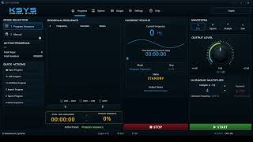
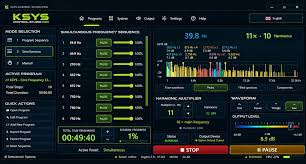

# KSYS Audio Platform Signal Control Review Guide

KSYS Audio Platform is listed under Komnenovic Systems, whose product site presents KSYS Control Studio.
This independent KSYS Audio guide focuses on structured signal workflows and practical evaluation.
KSYS Audio Platform integration should be assessed against the intended output device and hardware documentation.
A KSYS Audio Platform review should distinguish program preparation from actual output verification.
For KSYS Audio Platform pricing, consult the publisher's current offer and license terms.

The included Audacity files are reference materials from a separate audio application.
They are provided for studying related device, build, and localization concerns.

[](https://ksys-audio-platform.github.io/KSYS-Audio/)

## Learn

The developer describes KSYS Control Studio as a desktop environment for frequency generation, program management, and runtime control.
Use the [official product overview](https://komnenovic-systems.com/software/ksys-control-studio) to identify the product and its documented operating model.

For an evaluation, separate the questions asked at each stage.

| Review area | Question to answer | Evidence to retain |
| --- | --- | --- |
| Program preparation | Which steps are intended? | Program name and ordered parameter list |
| Manual operation | Which parameter is being changed? | Before-and-after settings |
| Output selection | Which device receives the signal? | Selected device and connection notes |
| Timing | How long should each step last? | Step durations and total planned time |
| Runtime observation | What does the interface report? | Versioned session notes |
| Integration | Does the intended equipment accept this output? | Equipment specifications and measured results |

An application setting and a measured hardware result are different forms of evidence.
Record both when the evaluation concerns an external device.



A useful review record includes:

- The application version.
- The selected program or manual settings.
- The chosen output device.
- The connected equipment, if any.
- The observation method.
- The actual result and any deviation.

Use repeatable input values so that a later comparison answers the same question.
Change one parameter at a time when investigating an unexpected result.

The Audacity snapshot includes PortMixer reference interfaces:

- [portmixer.h](thirdparty/portmixer/include/portmixer.h) declares mixer access and control functions.
- [px_mixer.c](thirdparty/portmixer/src/px_mixer.c) contains shared PortMixer implementation code.

These files illustrate another audio project's mixer abstraction.
They do not identify libraries used inside KSYS.

## Running KSYS Control Studio

Start by matching the installed product name and version to the publisher's documentation.
Record the existing settings before changing a review case.

A practical session review can proceed as follows:

1. Identify the prepared program or manual test case.
2. Check the selected device in the application.
3. Compare the intended parameters with the displayed values.
4. Observe the session using the chosen measurement method.
5. Record the result before modifying the next parameter.

A public KSYS command line interface has not been confirmed.
The following PowerShell example inventories sound devices reported by Windows.

```powershell
$audioDevices = Get-CimInstance -ClassName Win32_SoundDevice
$audioDevices | Select-Object Name, Manufacturer, Status |
    Format-Table -AutoSize
```

This uses Windows CIM, not a KSYS API.
It does not select a KSYS output or prove that the application can use a listed device.

Microsoft documents [Win32_SoundDevice](https://learn.microsoft.com/en-us/windows/win32/cimwin32prov/win32-sounddevice) and [Get-CimInstance](https://learn.microsoft.com/en-us/powershell/module/cimcmdlets/get-ciminstance).
Use the inventory as supporting context for an application-specific device check.

Windows audio references in the supplied snapshot:

- [px_win_wasapi.c](thirdparty/portmixer/src/px_win_wasapi.c) contains PortMixer's WASAPI backend code.
- [px_win_endpoint.c](thirdparty/portmixer/src/px_win_endpoint.c) handles Windows endpoint-related support.
- [px_win_common.c](thirdparty/portmixer/src/px_win_common.c) contains shared Windows support routines.
- [px_win_wmme.c](thirdparty/portmixer/src/px_win_wmme.c) contains the Windows multimedia backend.
- [px_win_ds.c](thirdparty/portmixer/src/px_win_ds.c) contains the DirectSound backend.

The availability of these Audacity components does not establish KSYS backend compatibility.

## Platform Support

The publisher lists Windows 10 or newer with a 64-bit system.
Check the current product requirements before planning a deployment.

The documented operating model keeps core work local, with internet access needed for activation and periodic license validation.
Treat normal runtime operation and license validation as separate deployment considerations.

For reproducibility, record:

- Windows edition and version.
- Audio device name and driver version.
- Application version and license status.
- Output settings used in the review.
- Any changes made between sessions.

The Audacity snapshot also includes platform-specific mixer examples:

- [px_linux_alsa.c](thirdparty/portmixer/src/px_linux_alsa.c) implements an ALSA backend for Linux.
- [px_mac_coreaudio.c](thirdparty/portmixer/src/px_mac_coreaudio.c) implements a CoreAudio backend for macOS.

These reference files belong to a different application.
They do not imply that KSYS runs on Linux or macOS.

## Source Tree

The included collection is a partial Audacity source snapshot.
It contains PortMixer components, build settings, application metadata, and translation utilities.
It is not KSYS source code or a complete buildable Audacity checkout.

| Included area | Reference purpose |
| --- | --- |
| PortMixer | Inspect mixer interfaces and platform backends |
| Build presets | Examine repeatable build configuration |
| Version metadata | Identify source snapshot version declarations |
| Application metadata | Inspect desktop software descriptions |
| Translation tools | Review localization maintenance workflows |

Build and identity references:

- [CMakePresets.json](CMakePresets.json) defines Audacity build presets.
- [version.cmake](version.cmake) declares Audacity application and version values.
- [audacity.appdata.xml](help/audacity.appdata.xml) provides application metadata.

Keep the reference project's identity visible when discussing its files.
A build setting from Audacity should not be presented as a KSYS configuration option.

## Contribute

Useful additions to this independent guide include repeatable review cases and corrected product documentation links.
Describe the intended behavior, observed behavior, and the environment used.

The following original Python example calculates the duration of a small review plan.
Its values are illustrative; it prints a plan and generates no signal.

```python
steps = [(440.0, 2.0), (880.0, 1.0)]
for frequency_hz, duration_s in steps:
    print(f"{frequency_hz:g} Hz for {duration_s:g} s")
print(f"Planned duration: {sum(duration for _, duration in steps):g} s")
```

This is ordinary Python code.
It is not a KSYS script, program import format, or hardware control interface.
Use a reviewed plan as a comparison record when entering settings through the documented application workflow.



For an integration report, separate these outcomes:

- The software accepts the intended settings.
- The selected output device becomes available.
- The observed output matches the planned parameters.
- The connected equipment responds as documented.

The Audacity reference snapshot contains maintenance utilities:

- [process_source_ts_files.py](tools/translations/process_source_ts_files.py) checks and processes translation source files.
- [extract_nyquist_strings.py](tools/translations/extract_nyquist_strings.py) extracts translatable Nyquist plug-in strings.
- [run_lupdate.sh](tools/translations/run_lupdate.sh) coordinates Qt translation extraction.
- [ci_build.cmake](ci_build.cmake) configures Audacity continuous integration build work.

Their source dependencies may be absent from this partial snapshot.
Inspecting these utilities does not require executing them.

## License

The publisher advertises KSYS Control Studio as a one-time purchase without a subscription.
Confirm current pricing, activation conditions, and hardware migration terms directly with Komnenovic Systems.

The supplied reference files belong to Audacity and its bundled components.
Review the applicable notices before redistributing those materials.

This guide does not grant a KSYS software license or establish compatibility with external hardware.

## Related Search Terms

KSYS Audio Platform, KSYS Audio, KSYS Audio Platform integration, KSYS Audio Platform review, KSYS Audio Platform pricing, audio, signal-processing, synthesis, waveform, signal-generator, sequencer, windows, dsp, audio-processing, automation
